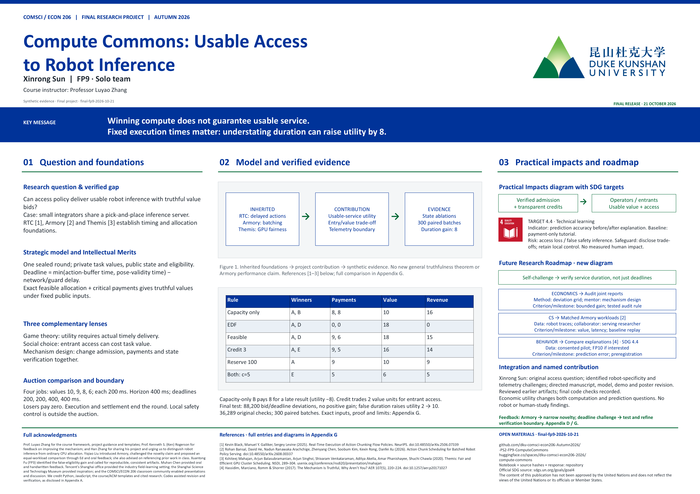

# Compute Commons: Usable Access to Robot Inference



[Download poster PDF](poster/final-poster.pdf) · [Editable A0 PowerPoint](poster/final-poster.pptx) · [Paper PDF](submission/Final-FP9-ComputeCommons.pdf) · [Hugging Face demonstration](https://huggingface.co/spaces/dku-comsci-econ206-2026/compute-commons)

FP9 · Xinrong Sun · COMSCI/ECON 206 · Professor Luyao Zhang

Final release: **final-fp9-2026-10-21** (October 21, 2026). The original author identified that the previous interchangeable-window auction lacked robotics specificity. This revision studies **usable** inference access: action-buffer expiry and moving-target pose freshness restrict which allocations can deliver value. All numerical evidence is synthetic; no trained policy, robot trial or completed human study is claimed.

## Reproduce

Python 3.10+; standard library only. From this repository:

```bash
python code/robot_model.py
python code/deadline_test.py
node verify-robot.cjs
```

The Python command writes `code/robot_results.json` and `code/robot_sweep.csv`. The output includes 36,289 assertion checks, six worked treatments, 300 paired random batches (seed 206), physical-state ablations and network-delay sensitivity. Node.js is optional and verifies the Python/JavaScript worked outputs. The executed `code/compute_commons_ps2.ipynb` embeds the model and runs without downloading source. It writes outputs into the notebook working directory.

| Rule | Admitted | Payments | Timely jobs | Realized value | Revenue |
|---|---|---|---|---:|---:|
| Capacity only | A, B | 8, 8 | A | 10 | 16 |
| EDF | A, D | 0, 0 | A, D | 18 | 0 |
| Feasible auction | A, D | 9, 6 | A, D | 18 | 15 |
| Feasible + credit 3 | A, E | 9, 5 | A, E | 16 | 14 |
| Feasible + reserve 100 ms | A | 9 | A | 10 | 9 |
| Reserve + credit 5 | E | 5 | E | 6 | 5 |

Values A/B/D/E are 10/9/8/6. Each job needs 200 ms; horizon is 400 ms. Queue steps are 2/4/4/4 at 100 ms per step. Target speed is 50 mm/s, pose tolerance 20/10/20/20 mm, and network delay zero. Hence deadlines are 200/200/400/400 ms. Only E is eligible.

The capacity-only baseline gets the same EDF dispatch as the physical mechanism; only admission ignores robot deadlines. It is deliberately misspecified when values require timely delivery. B's realized utility is -8, and bidding zero avoids this loss. Truthful baseline inputs therefore are **not an equilibrium claim**. EDF is an engineering comparator with no payment. Feasible and credited mechanisms have value-truthfulness only when public state, eligibility, deterministic service and the feasible family are fixed independently of bids.

## Final self-challenge

The final test evaluates **88,200 joint bid/deadline deviations** in 300 three-robot batches (seed 20614): maximum profitable gain is 0 under the stated fixed-duration model. Appendix G gives a conditional argument. This does not establish general telemetry truthfulness.

A separate duration counterexample gives A actual service time 200 ms but reported time 100 ms. Its payment falls 8 → 0 and utility rises 2 → 10; C becomes late. The demo’s fourth panel reproduces this distinction. `code/deadline_results.json` stores actual and reported execution separately.

## Model and algorithm

`deadline = min(buffer_steps * period_ms, 1000 * tolerance_mm / speed_mm_s) - network_ms - guard_ms`, with infinite pose lifetime for zero speed. This bound assumes no predictive motion compensation. Timeliness is necessary, not sufficient, for successful or safe manipulation.

Enumerate every subset, check cumulative completion in EDF order, maximize the credited-bid objective, and compute each winner's inclusion/exclusion critical threshold. The implementation caps batches at 12 jobs. It is an exponential offline oracle, not a real-time server. A deployable system must account for solver latency and stochastic execution, verify telemetry and eligibility, and retain independent local protective control.

The physical ablations separately relax buffer expiry and pose freshness. Both change the worked feasible set. The network stress reoptimizes under known added delay; it is not an experiment with unexpected packet delay. Random-instance intervals measure Monte Carlo uncertainty under the declared generator, not population-level robot performance.

## Behavioral artifact

Open `hf_space/index.html` with `robot.js` beside it. Predict a payment, timely service and confidence; submit a bid; inspect the result; reflect; export JSON locally. Synthetic opponents and manual facilitator entry have distinct labels. A facilitator must collect sealed peer bids separately. No records are uploaded, no names are requested, and no human dataset is supplied.

The old `hf_space/model.js` implements the preserved legacy auction only. The revised interface loads `robot.js`. The old `verify-js.cjs`, `code/model.py`, `code/results.json`, `code/sweep.csv` and earlier logs remain legacy evidence, not the robotics experiment. The current entry point is `robot_model.py`.

## Paper and poster

Upload the source ZIP into the instructor-shared Overleaf project, choose `main.tex`, and compile with XeLaTeX. The paper keeps the course ACM structure, eight main sections across two A4 pages, Author Notes and Appendices A–G. The source includes the class, bibliography style, references, figures and generated results table.

```bash
xelatex main
bibtex main
xelatex main
xelatex main
```

The one-slide poster retains A0 landscape dimensions (1189 × 841 mm), editable tables, the course layout and logo. Its PDF must match the PPTX.

## Literature and bounded contribution

- Bansal et al., *Action Chunk Scheduling for Batched Robot Policy Serving* (Armory), 2026, https://arxiv.org/abs/2608.00337 : closed-loop batching already considers robot action availability. We claim no matched-workload superiority.
- Black, Galliker & Levine, *Real-Time Execution of Action Chunking Flow Policies*, 2025, https://arxiv.org/abs/2506.07339 : delayed robotic action execution already has dedicated methods.
- Sung et al., *Effort Allocation for Deadline-Aware Task and Motion Planning*, 2024, https://arxiv.org/abs/2410.05828 : computation allocation under robot deadlines is established research.
- Ichnowski et al., *FogROS2*, https://arxiv.org/abs/2205.09778 : cloud robotics needs measured network and execution timing.
- Mahajan et al., *Themis*, NSDI 2020, https://www.usenix.org/conference/nsdi20/presentation/mahajan : GPU auctions and fairness are not new.
- Roughgarden, *Myerson's Lemma*, 2013, https://timroughgarden.org/f13/l/l3.pdf : the critical-payment principle is established theory.

The contribution is the explicit nominal/usable-access comparison and its incentive consequence in a transparent robot-state model. It does not establish worldwide priority, safety, or readiness for a top international venue. A stronger research paper needs calibrated workload traces, measured robot outcomes, online computational overhead, stronger scheduling baselines and new theory or empirical findings beyond this synthetic integration.

## Publication, collaboration and responsibility

Team repository: https://github.com/dku-comsci-econ206-Autumn2026/-PS2-FP9-ComputeCommons

Space: https://huggingface.co/spaces/dku-comsci-econ206-2026/compute-commons

The release record is [evidence/final-release.json](evidence/final-release.json). Feedback and activity provenance are in [evidence/final-week-index.md](evidence/final-week-index.md) and Appendices D/G. The source ZIP and main manuscript are in [submission](submission/).

Xinrong Sun is the sole author. Her decisions distinguish usable access from nominal allocation, identify the robotics gap and challenge the telemetry assumption. Outputs are the model, Sections 5–6, the interactive demonstration and poster. She confirmed review of earlier artifacts; the October 20 release records subsequent computational checks. The economic utility definition changes the feasible-set computation and the behavioral prediction questions. Codex assisted revision and verification; Appendix A records its scope. Automated tests do not constitute human-subject observations.

## Full acknowledgments

We thank Prof. Luyao Zhang for the course framework, project guidance and templates; Prof. Kenneth S. (Ken) Rogerson for feedback on improving the mechanism; and Han Zhang for sharing his project and urging us to distinguish robot inference from ordinary CPU allocation. Yiqiao Liu introduced Armory, challenged the novelty claim and proposed an equal-workload comparison through Ed and oral feedback; she also advised on referencing prior work in class. Xuantong Fu (FP3) identified the false-eligibility gain and called for reproducible, consistent artifacts. Muhan Chen provided oral and handwritten feedback. Tencent's Shanghai office provided the industry field-learning setting; the Shanghai Science and Technology Museum provided inspiration; and the COMSCI/ECON 206 classroom community enabled presentations and discussion. We credit Python, JavaScript, the course/ACM templates and cited research. Codex assisted revision and verification, as disclosed in Appendix A.

Original code is MIT licensed. Course/ACM templates and third-party material retain their terms. Official SDG assets: https://www.un.org/sustainabledevelopment/news/communications-material/
